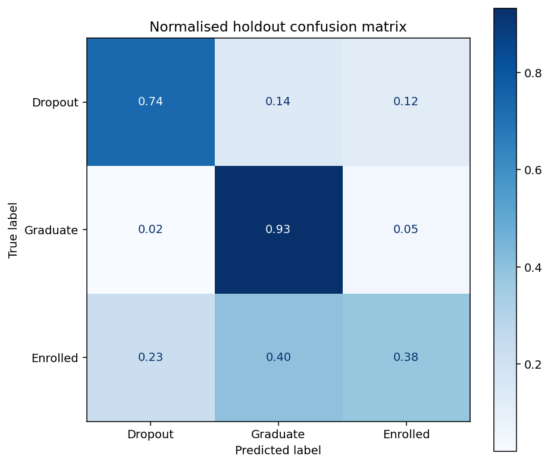

# Student outcomes: prediction and exploratory profiles

This Machine Learning project compares models for students' final outcomes and
second-semester grades, then uses PCA and clustering to explore academic
profiles. The experiment uses scikit-learn estimators, with a shared
holdout, preprocessing inside cross-validation folds and separate evaluation
for classification and regression.



Saved course-data result from 17 October 2026. Each row sums to approximately one
and shows how students with that actual outcome were classified. For example,
0.93 of graduates were predicted as graduates. The holdout was historically
explored, so these scores are descriptive evidence from this experiment, not an
independent estimate of future deployment performance.

## Run the synthetic example

The commands below were checked with **CPython 3.12.2 on macOS** and
**3.12.14**. Other Python versions have not been checked. Run from this
project folder:

```bash
python -m venv .venv
source .venv/bin/activate
python -m pip install --upgrade pip
python -m pip install -r requirements.txt
python main.py --data data/synthetic_students.csv --output results/synthetic_smoke --folds 2 --synthetic
```

On Windows, activate with `.venv\Scripts\activate` instead. The included CSV has
180 **entirely fictitious** rows and uses the same column contract as the course
data. A complete run starts with:

```text
Rows: 180; train: 144; holdout: 36; folds: 2
Classification CV: LogisticRegression
```

The command runs both supervised tasks and both clustering variants, then writes
model comparisons, plots, metrics and `run_metadata.json` to the chosen output
folder. This complete command was checked on macOS on 26 October 2026, including
all seven models per supervised task, both restricted searches and both clustering
variants. Its scores demonstrate execution and have no educational interpretation.
[A new synthetic regression plot](docs/technical-notes.md#synthetic-macos-example)
shows the predictions and residuals from that run. The main image above remains
the separately labelled historical course-data result.
Choose a different output folder to keep earlier runs: existing files with the
same names are overwritten. The fixture generator and input contract are
explained in [the data notes](data/README.md).

## Methods

| Part | Implementation and role |
|---|---|
| Classification | Seven scikit-learn classifiers: logistic regression, KNN, decision tree, random forest and Gradient Boosting, including two balanced variants |
| Regression | Seven regressors: Ridge, Lasso, Elastic Net, KNN, decision tree, random forest and Gradient Boosting |
| Preprocessing | Fixed binary mapping, then fold-local one-hot encoding and scaling in a scikit-learn pipeline |
| Selection | The original five-configuration Gradient Boosting search, selected using training cross-validation |
| Profiles | Library PCA, K-means and Ward clustering on selected numeric/binary fields, with and without second-semester variables |

Both supervised tasks use one outcome-stratified 80/20 split with seed 42. EDA
uses training rows. The classification comparison includes a depth-4 Gradient
Boosting baseline that is absent from the restricted depth-3/depth-5 search;
the search therefore does not select the best of all compared models.

## Historical results and their limits

The saved full-data run used 4,424 rows: 3,539 for training and 885 for holdout,
with five-fold cross-validation. [Its result folder](results/corrected_full/README.md)
contains full-precision scores, settings and dataset/split hashes.

| Task | Saved holdout metrics | Selected Gradient Boosting configuration |
|---|---|---|
| Classification | Accuracy 0.7695; macro-F1 0.6914 | 100 trees; depth 3; learning rate 0.1 |
| Regression | R² 0.7859; RMSE 2.4358; MAE 1.3449 | 200 trees; depth 3; learning rate 0.05 |

The **holdout was historically explored**. A corrected split cannot make it
unseen, and changed regression membership prevents an unchanged-test-set
comparison with earlier scores. Classification includes second-semester records,
so it is not an early-warning model. Regression excludes all six second-semester
fields and the final outcome, but administrative predictor timestamps remain
unverified. Zero grades are retained without assuming their cause.

Clustering describes the full dataset. Silhouette favours k=2 in both variants;
the reported k=3 profiles retain an interpretation informed by the three outcome
classes. K-means ARI is 0.1558 with second-semester fields and 0.0961 without them.
Outcome colouring and ARI are post-fit comparisons. Neither clusters nor feature
importance establish causality.

## Course data and notebook

The real course CSV is not distributed. To rerun that experiment, obtain an
authorised local copy with the documented schema, source and translation mapping:

```bash
python main.py --data /path/to/authorised_students.csv --output results/local_run
```

Replace the placeholder with an existing CSV. This command defaults to five
folds; it was not repeated without the original data. A similarly named public
dataset is not assumed to be identical. The exact file hash is recorded in
`results/corrected_full/run_metadata.json`.

`student_outcomes.ipynb` imports the same project modules and defaults to the
synthetic fixture. For use in an existing Jupyter installation:

```bash
python -m pip install -r requirements-notebook.txt
```

Open it with this folder as the working directory. It writes to
`results/notebook_demo/`; copy the project first if you want to retain that run.
The saved notebook outputs are synthetic. Sequential cell execution is checked;
execution through a real Jupyter kernel remains unverified.

## Tests and project layout

```bash
python -m unittest discover -s tests -v
```

Seven tests cover shared split membership, regression exclusions, fold-local
preprocessing, unseen categories, zero-grade handling, model settings and input
immutability. All seven passed on macOS with Python 3.12.2; `pip check` reported
no dependency conflicts. They do not validate educational predictions. The
synthetic CLI also completes every configured task. Four initial input-contract
tests and the seven above passed on Python 3.12.2 on macOS (11 tests). The final
schema correction also requires the pass-through predictor
`asignaturas_1sem_convalidadas`; a fifth input-contract test checks that its
absence is rejected. All 12 tests passed on Linux with Python 3.12.14 after this
correction. [Technical notes](docs/technical-notes.md) record the evaluation
design and tested environment.

| File or folder | Purpose |
|---|---|
| `main.py`, `config.py` | Run orchestration and original experiment settings |
| `preprocessing.py` | Data loading, shared split and task-specific predictors |
| `classification.py`, `regression.py` | CV comparisons, restricted search and holdout evaluation |
| `unsupervised.py`, `eda.py`, `plots.py` | Exploratory profiles and figures |
| `data/`, `data_schema.csv` | Fictitious fixture and source-column contract |
| `results/corrected_full/` | Historical course-data outputs; no student-level predictions |

Individual Machine Learning submission, iMAT, ICAI, Universidad Pontificia
Comillas, 2025–2026. Scikit-learn supplies the learning algorithms. Post-submission
corrections introduced the shared split and fold-local preprocessing while
retaining the original model settings and restricted searches.
