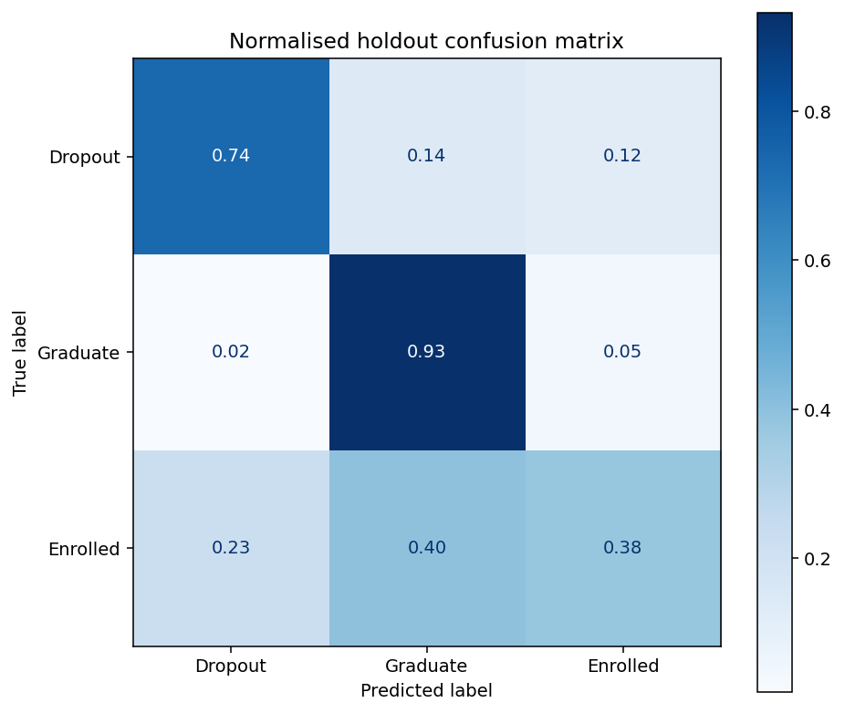

# Student outcomes: prediction and exploratory profiles

Compare models for student dropout, graduation and second-semester grades, then
explore academic profiles with PCA and clustering. The project uses scikit-learn
models; the Python modules handle data preparation, model comparisons and
evaluation.

Individual Machine Learning coursework, iMAT, ICAI, Universidad Pontificia
Comillas, 2025–2026.

[Run the example](#how-to-run) · [Results](#saved-results) · [Code guide](#repository-structure) · [Evaluation details](docs/technical-notes.md)

<a href="results/corrected_full/classification_confusion_normalised.png"></a>

Rows show actual outcomes and sum to approximately one: 93% of graduates were
classified as graduates. **The holdout was explored during earlier analysis**,
so this is a description of the saved experiment, not an independent estimate
of performance on future students.

## What the code does

- Compares seven classification models for the three final outcomes, including
  two balanced variants.
- Compares seven regressors for second-semester grades, excluding the final
  outcome and all six second-semester fields from the predictors.
- Explores student profiles using PCA, K-means and Ward clustering, with and
  without second-semester variables.

Both supervised tasks use the same outcome-stratified 80/20 split. Preprocessing
is fitted inside the cross-validation folds. A small training-CV search selects
Gradient Boosting settings; it does not search every model in the comparison.

## Saved results

The course-data experiment used 4,424 rows, with 3,539 for training, 885 for
holdout evaluation and five-fold cross-validation. The selected Gradient
Boosting models gave:

| Task | Holdout metrics |
| --- | --- |
| Classification | Accuracy 0.7695; macro-F1 0.6914 |
| Regression | R² 0.7859; RMSE 2.4358; MAE 1.3449 |

These results use the original course data, which are **not included**. The
[results guide](results/corrected_full/README.md) identifies the saved files and
settings. The included synthetic example demonstrates the pipeline and has
separate scores.

## How to run

Use Python 3.12 and run from the project folder:

```bash
python3.12 -m venv .venv
source .venv/bin/activate
python -m pip install --upgrade pip
python -m pip install -r requirements.txt
python main.py --data data/synthetic_students.csv --output results/synthetic_smoke --folds 2 --synthetic
```

The 180-row CSV is entirely fictitious. The command writes model comparisons,
plots and metrics to `results/synthetic_smoke/`. Choose a new output folder to
keep previous runs: matching files in an existing folder are overwritten.

To use an authorised real CSV, follow the [data contract](data/README.md).
The [technical notes](docs/technical-notes.md#running-other-data-and-the-notebook)
cover that command and the notebook, whose saved outputs are also synthetic.

## Repository structure

```text
student-outcomes-ml/
├── main.py                    # Experiment workflow and command-line options; start here
├── preprocessing.py           # Shared splits, encoding and scaling
├── classification.py          # Model comparisons and parameter searches
├── regression.py              # Model comparisons and parameter searches
├── unsupervised.py            # PCA and clustering
├── eda.py                     # Descriptive plots
├── plots.py                   # Shared plotting helpers
├── config.py                  # Experiment settings and column lists
├── synthetic_data.py          # Generator for the fictitious example CSV
├── student_outcomes.ipynb     # Notebook entry point using the same modules
├── data_schema.csv            # Column schema, not the data
├── requirements.txt
├── requirements-notebook.txt  # Notebook support dependencies
├── data/                      # Synthetic input and the data contract
├── results/
│   └── corrected_full/        # Saved course-data results
├── docs/
│   ├── technical-notes.md     # Evaluation details and notebook instructions
│   └── images/                # Figure
└── tests/                     # Input-contract and pipeline checks
```

## Tests and limits

```bash
python -m unittest discover -s tests -v
```

The tests cover split membership, preprocessing, predictor exclusions and the
input contract. They do not measure predictive value for a new student cohort.

- The historically explored holdout limits the interpretation of all reported
  scores; a consistent split cannot undo earlier exploration.
- Classification includes second-semester information, so it is not an
  early-warning model. Collection times for administrative fields are not
  established.
- Clustering is descriptive and uses all rows; the three-cluster interpretation
  was informed by the known outcomes. Neither clustering nor feature importance
  establishes causality.
- The real CSV is absent, and live Jupyter-kernel execution has not been checked.
  The command-line example does not validate that integration.

See the [evaluation notes](docs/technical-notes.md) for the restricted search,
zero grades and other modelling choices.
