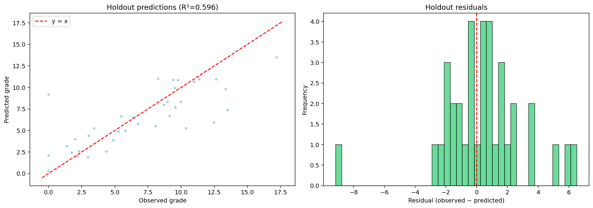

# Evaluation and running notes

The [README](../README.md) gives the project overview, saved metrics and a
synthetic example. The [data contract](../data/README.md) describes the input
schema. The real course CSV is not distributed.

## Splits and preprocessing

Both supervised tasks share an outcome-stratified 80/20 split with seed 42.
Classification cross-validation is stratified; regression uses shuffled KFold
with the same seed. Training rows alone fit the one-hot vocabulary and scaler
inside each fold. Unknown categories become all-zero dummy columns. The fixed
`si`/`no` mapping estimates no statistics.

Exploratory plots use the training rows. The supervised tasks compare seven
classifiers and seven regressors before a restricted Gradient Boosting search.
The selected classification model has 100 trees, depth 3 and learning rate 0.1;
the selected regression model has 200 trees, depth 3 and learning rate 0.05.

The classification comparison includes a depth-4 baseline, but the search only
tests depths 3 and 5. Selecting the best grid entry therefore does not select
the best model across all comparisons. The regression depth-3 baseline and
matching grid entry both give CV R² 0.757912598 in the saved course-data run.
Selection uses training CV rather than holdout metrics.

## Interpreting the course-data results

Historical classification EDA included 724 of the 885 original regression
holdout rows. Sharing one split now makes membership consistent but cannot undo
earlier exploration. This observation does not by itself show that holdout
targets were used during fitting. The regression holdout also has different
membership, so scores cannot be compared on an unchanged independent test set.

The course data contain 870 zero second-semester grades, including 469 with
positive evaluation counts. These values are retained without assigning them a
cause. Collection times for administrative predictors are not established.
There is no evaluation on an external cohort, a later cohort or a prospective
service.

Clustering describes the full dataset. The variant without second-semester
fields still includes first-semester information. Outcome labels are not
clustering inputs: colouring and adjusted Rand index are post-fit comparisons.
Silhouette favours k=2; interpreting k=3 was informed by the three known outcome
classes. Clusters and feature importance describe associations, not causes.
The repository does not distribute a trained model or student-level predictions.

## Running other data and the notebook

For an authorised real CSV matching the data contract, replace the input path
and use a new output directory:

```bash
python main.py --data /path/to/authorised_students.csv --output results/local_run
```

The default is five folds. A similarly named public dataset is not assumed to
be the same source file. Dependencies are listed in `requirements.txt`; the
saved result metadata records the environment for that experiment. Use Python
3.12 for the documented setup, rather than assuming compatibility with every
later release.

On Windows, activate the virtual environment with `.venv\Scripts\activate`
instead of the macOS/Linux `source` command.

`student_outcomes.ipynb` calls `main.run` and defaults to synthetic data, writing
to `results/notebook_demo/`. Its saved cell outputs are synthetic too. To use
real data, change both the path and synthetic flag, and use five folds for the
full experiment. `main.run` creates missing output directories, but matching
files are overwritten: choose a separate folder for each run.

Notebook support dependencies are in `requirements-notebook.txt`. A real
Jupyter-kernel run has not been checked; sequential Python execution and valid
notebook structure do not demonstrate kernel integration.

## Reading the synthetic example



Each point is one of 36 fictitious holdout rows. The residual is observed minus
predicted grade. The displayed Gradient Boosting model used 100 trees, depth 3
and learning rate 0.1, with R² 0.5964, RMSE 2.7682 and MAE 1.9411. Classification
accuracy in the same synthetic run was 0.2778 and macro-F1 was 0.2586. These
scores only illustrate the software's output.

Generate a separate set of synthetic outputs with:

```bash
python main.py --data data/synthetic_students.csv --output results/synthetic_smoke --folds 2 --synthetic
```

The regression plot is written to
`results/synthetic_smoke/regression_predictions.png`. The included figure is
the existing saved output; a new run is separate from both that figure and the
course-data experiment. This command runs the CLI, not a Jupyter kernel.
