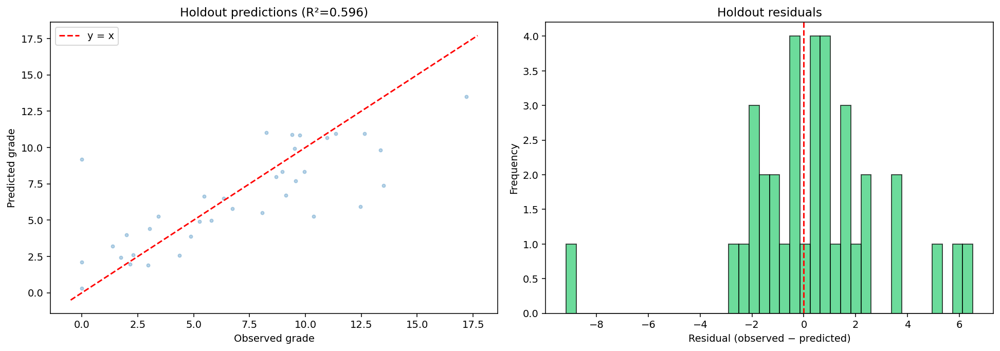

# Evaluation and preprocessing

The [README](../README.md) gives the run commands, saved metrics and main limits.
The real CSV is not included; [the data contract](../data/README.md) describes
its schema and integrity hash.

Both tasks share an outcome-stratified 80/20 split. Classification CV is stratified;
regression uses shuffled KFold with seed 42. Within each fold, training rows alone
fit the one-hot vocabulary and scaler. Unknown categories become all-zero dummies;
the fixed `si`/`no` mapping estimates no statistics.

The classification comparison baseline has depth 4, outside the restricted
search's depths 3 and 5. The regression depth-3 baseline and matching grid entry
both give CV R² 0.757912598 in the saved full run. Selection uses training CV,
not holdout metrics; it does not select among every possible model or setting.

Historical classification EDA contained 724 of the 885 original regression holdout
rows. The shared split makes membership consistent but cannot undo exploration.
It does not establish that the original fit used holdout targets. Changed
regression membership also prevents comparison on an unchanged independent test set.

The course data have 870 zero second-semester grades, including 469 with positive
evaluation counts. These values are retained without assigning a cause.
Administrative predictor observation times remain unresolved. No external cohort,
temporal validation or prospective service has been evaluated.

Clustering describes the full dataset. The variant without second-semester fields
still includes first-semester information. Outcome labels are not clustering
inputs; colouring and ARI are post-fit comparisons. The k=3 interpretation is
informed by the three known outcome classes although silhouette favours k=2.
Feature importance and clustering are descriptive, not causal. No trained model
or student-level prediction table is included.

The notebook calls `main.run`, which creates its output directory, including
missing parents. By default it writes synthetic results to `results/notebook_demo/`.
Its saved cell outputs are also synthetic. Changing to a real dataset requires
updating the path and synthetic flag, and using five folds for the full experiment.
Keep a distinct output directory to avoid overwriting results you want to retain.

## Tested environment and execution

Checked environments use CPython 3.12.2 on macOS and CPython 3.12.14, with pip
26.2.2. The direct runtime packages remain NumPy 2.5.4, pandas 3.0.6, SciPy 1.18.1,
scikit-learn 1.8.0, Matplotlib 3.10.8, seaborn 0.13.2 and threadpoolctl 3.6.0, as specified in
`requirements.txt`. Notebook dependencies are nbformat 5.11.1, nbclient 0.11.0
and ipykernel 7.4.0. These package versions were recorded in the macOS run as
well. Other Python versions have not been checked.

The full synthetic CLI execution uses 180 fictitious rows, 144 training rows,
36 holdout rows and two CV folds. It exercises all configured model comparisons,
Gradient Boosting grids, plots and both clustering variants. The seven original
unit tests also passed on macOS, and `pip check` reported no dependency conflicts.
The 26 October macOS run completed the CLI and wrote 50 output files, including
26 figures. These checks do not reproduce the historical course-data results:
the authorised source CSV is absent.

The notebook's code cells can execute sequentially in Python using the same
modules. A real Jupyter kernel remains unverified; installing its dependencies
or validating the notebook structure does not demonstrate kernel execution.
The `prepared_version_date` field describes the prepared code version, not a
new run's wall-clock date. Keep the output directory and run date separately
when recording new experiments.

## Synthetic macOS example



Unedited output of the existing regression plotting function, executed on macOS
with Python 3.12.2 on 26 October 2026. Each point comes from one of the 36
**fictitious** holdout rows; the residual is observed minus predicted grade.
The selected Gradient Boosting model used 100 trees, depth 3 and learning rate
0.1. R² was 0.5964, RMSE 2.7682 and MAE 1.9411 on this fixture. These values check
the software's output and say nothing about prediction for real students.

The same synthetic run's classification accuracy was 0.2778 and macro-F1 was
0.2586. The fixture does not establish a useful outcome classifier. The historical
course-data confusion matrix remains the README's main figure because it belongs
to the actual academic experiment, with its limitations stated alongside it.

To regenerate the synthetic outputs, run from the project folder after installing
`requirements.txt`:

```bash
python main.py --data data/synthetic_students.csv --output results/synthetic_smoke --folds 2 --synthetic
```

The plotted file is `results/synthetic_smoke/regression_predictions.png`. Use a
new output directory to retain previous runs. The image included here is a direct
copy from the completed macOS execution; no data points or image pixels were
changed. This command executes the CLI, not the notebook or a Jupyter kernel.
